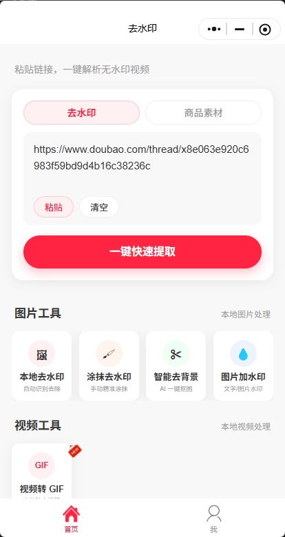
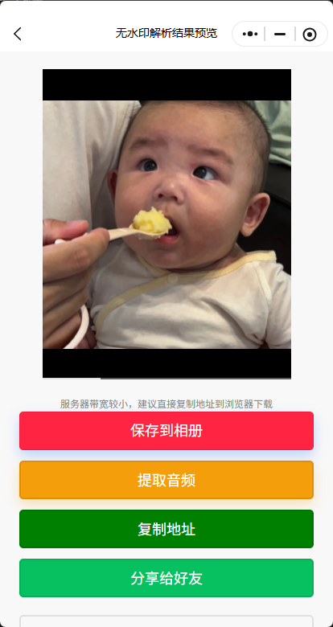

# 豆包去水印 · 速析去水印

> 粘贴豆包分享链接，提取无水印视频。微信小程序、安卓、Windows / Mac 桌面端都能用，也可以用开放平台 API 接到自己的系统里。

官网：[sx.novidark.top](https://sx.novidark.top/)

<p align="center">
  
</p>

<p align="center">
  <strong>微信扫一扫，或在微信里搜索「速析去水印」</strong>
</p>

<p align="center">
  <a href="https://sx.novidark.top/downloads/suxi-watermark-1.0.0.apk"><b>下载安卓 1.0.0</b></a>
  &nbsp;·&nbsp;
  <a href="https://sx.novidark.top/downloads/suxi-watermark-1.0.7-x64-setup.exe"><b>下载 Windows 1.0.7</b></a>
  &nbsp;·&nbsp;
  <a href="https://sx.novidark.top/downloads/suxi-watermark-1.0.3-mac-x64.dmg"><b>下载 Mac Intel 1.0.3</b></a>
  &nbsp;·&nbsp;
  <a href="https://sx.novidark.top/open"><b>开放平台 API</b></a>
</p>

---

## 四个入口

| 产品 | 能做什么 | 打开方式 |
|---|---|---|
| **微信小程序** | 粘贴链接，预览后保存到相册 | 扫上方小程序码，或微信搜索「速析去水印」 |
| **安卓 1.0.0** | 提取素材，并用手机上的智能工具和文档转换 | [下载 APK](https://sx.novidark.top/downloads/suxi-watermark-1.0.0.apk) |
| **桌面端** | 快捷键读剪贴板，一次最多解析 100 条，本地下载 | [Windows 1.0.7](https://sx.novidark.top/downloads/suxi-watermark-1.0.7-x64-setup.exe) · [Mac Intel 1.0.3](https://sx.novidark.top/downloads/suxi-watermark-1.0.3-mac-x64.dmg) |
| **开放平台 API** | 把同一套解析接到自己的网站或工具里 | [开放平台](https://sx.novidark.top/open) · [控制台](https://sx.novidark.top/account) |

小程序、安卓、桌面端和 API 走同一套解析。

---

## 豆包怎么提取

在豆包 App 或网页里点 **分享 → 复制链接**，回到速析粘贴。从分享面板复制的链接，才能拿到无水印版本。

<table>
  <tr>
    <td align="center"><b>首页 · 粘贴链接解析</b></td>
    <td align="center"><b>结果页 · 无水印预览下载</b></td>
  </tr>
  <tr>
    <td></td>
    <td></td>
  </tr>
</table>

支持的豆包链接：

```text
https://www.doubao.com/thread/x8e063e920c6983f59bd9d4b16c38236c
```

```text
https://www.doubao.com/video-sharing?share_id=...&video_id=...
```

`/thread/` 对话分享、`video-sharing` 视频分享、`music-sharing` 音乐分享，以及飞书云文档 `drive/file` 链接，都按同样方式粘贴。请保留完整参数。

1. 打开小程序、安卓或桌面端
2. 在豆包里复制分享链接
3. 粘贴后点「一键快速提取」
4. 预览无水印结果，保存到相册、复制下载地址，或提取音频

视频较大时，用「复制地址」到浏览器、桌面端或安卓下载。

---

## 微信小程序

搜索 **速析去水印** 即可使用。

- 粘贴公开链接，预览视频、图片和文案后保存
- 合集可选当前一条，或整份提取
- 相册图片：本地去水印、涂抹去水印、智能去背景、加水印
- 视频转 GIF

免费用户批量解析每次最多 5 条。月度会员每日可使用本地工具 8 次，年度会员 18 次；会员批量解析每次最多 100 条，并去除广告，可使用桌面端。链接解析另计，不占用本地工具次数。

---

## 安卓

当前版本 **1.0.0**。[直接下载安装包](https://sx.novidark.top/downloads/suxi-watermark-1.0.0.apk)，或打开 [下载页](https://sx.novidark.top/desktop)，把鼠标放到「下载安卓版」，用手机扫码安装。

- 粘贴分享链接，保存视频、图片和文案
- 智能工具：去水印、去背景、降噪、人声分离、语音转文字
- 文档转换：PDF、Word、Excel、PPT、图片，以及文库下载
- 解析记录、额度和购买都在 App 里

保存位置是手机「下载 / 速析去水印」。用邮箱登录，和官网、桌面端是同一个账号。

---

## 桌面端

适合一次整理很多条公开链接。安装说明在 [桌面端页面](https://sx.novidark.top/desktop)。

| 系统 | 版本 | 安装包 |
|---|---|---|
| Windows | 1.0.7 | [suxi-watermark-1.0.7-x64-setup.exe](https://sx.novidark.top/downloads/suxi-watermark-1.0.7-x64-setup.exe) |
| Mac Intel | 1.0.3 | [suxi-watermark-1.0.3-mac-x64.dmg](https://sx.novidark.top/downloads/suxi-watermark-1.0.3-mac-x64.dmg) |

Mac 安装包适用于 Intel 芯片。打开 dmg 后，把应用拖进「应用程序」。

- 全局快捷键读取剪贴板，分享文案直接填入提取页
- 多条链接换行粘贴，或拖进窗口，一次最多 100 条
- 拖入图片进入图片修复，可切换清晰度后下载
- 结果留在本机历史里
- 邮箱注册成功后赠送 100 次额度，用完可在软件内购买

---

## 开放平台 API

需要把解析接到自己的网站、工具或工作流时，使用开放平台。注册后在控制台获取密钥，调用方式、在线调试和套餐都在官网页面里。

- 开放平台：[sx.novidark.top/open](https://sx.novidark.top/open)
- 控制台：[sx.novidark.top/account](https://sx.novidark.top/account)

桌面端使用同一个邮箱登录。

---

## 其他平台

抖音、快手、小红书、B 站、豆包、即梦、淘宝都可以从首页粘贴。短视频、图集、合集、部分公开主页、AI 创作分享和商品素材走同一个入口。已覆盖 100+ 平台，能否解析以当次结果为准。

[支持平台](https://sx.novidark.top/platforms) · [在线工具](https://sx.novidark.top/tools)（PDF 与 Word 互转、Suno 音乐下载、百度文库下载等）

---

## 常见问题

**链接复制对了，仍然解析失败**

完整分享链接才能解析。过期、已删除，或需要登录才能查看的内容，会解析失败。豆包请在分享面板里复制链接。

**小程序里视频保存失败**

微信对小程序下载有体积上限。点「复制地址」，用浏览器、桌面端或安卓保存。

**桌面端登录**

用邮箱登录或注册，流程与官网相同。注册成功赠送 100 次额度。

---

## 免责声明

只处理公开、未加密、未过期、无需登录即可访问的分享内容，供个人学习与合理使用。请尊重创作者与平台版权。解析依赖各平台公开分享能力，平台调整后，部分链接可能暂时不可用。

问题反馈：QQ [743007438](https://wpa.qq.com/msgrd?v=3&uin=743007438&site=qq&menu=yes) · [帮助与声明](https://sx.novidark.top/help)
